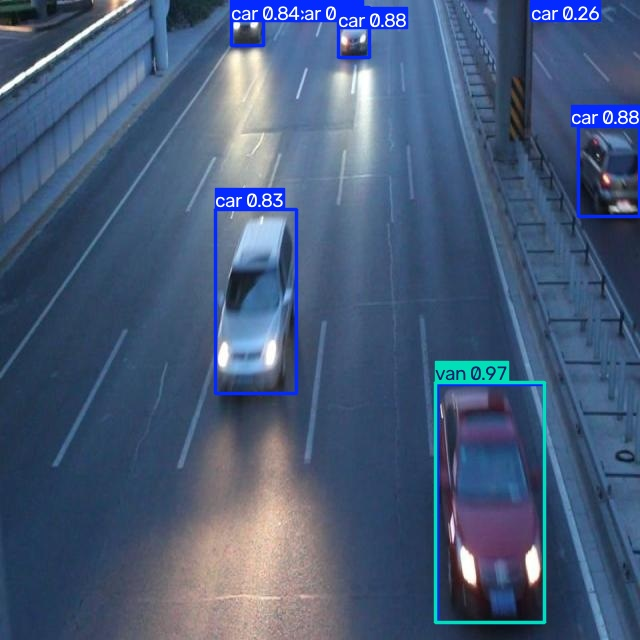

# Báo cáo cá nhân — Ngày 2: Object Detection cho ADAS

> **Học viên:** Dương Quang Chung · **MSSV:** 2A202603217 · **Lớp:** K5-L2A  
> **Ngày thực hành:** 09/11/2026 · **Mô hình:** YOLO26n  
> **Nguồn kết quả:** bộ nhãn do học viên gán, kết quả Gold QC đã chạy, và `day2_colab_outputs.zip` từ Google Colab.

## 1. Thông tin học viên

- **Họ tên:** Dương Quang Chung
- **MSSV:** 2A202603217
- **Email:** 26ai.chungdq@vinuni.edu.vn
- **Lớp:** K5-L2A
- **Link repo bài làm:** [https://github.com/chuns29/K5-L2A-Day02-DuongQuangChung-2A202603217-ObjectDetection](https://github.com/chuns29/K5-L2A-Day02-DuongQuangChung-2A202603217-ObjectDetection)
- **Link Colab đã chạy:** https://colab.research.google.com/github/chuns29/K5-L2A-Day02-DuongQuangChung-03217-ObjectDetection/blob/main/notebooks/day2_annotation_to_yolo.ipynb
- **Commit khóa nhãn ban đầu (CP4):** [`20d09aa087be6b81ee30cf0a274dfa9c9e0f4bb5`](https://github.com/chuns29/K5-L2A-Day02-DuongQuangChung-2A202603217-ObjectDetection/commit/20d09aa087be6b81ee30cf0a274dfa9c9e0f4bb5)

## 2. Schema và mini guideline

Bộ dữ liệu sử dụng bốn lớp cố định: `car` (ID 0, gồm sedan/SUV/taxi/pickup), `truck` (ID 1, xe tải chở hàng và đầu kéo), `bus` (ID 2, xe buýt và minibus chở khách), và `van` (ID 3, van/minivan). Quy định chi tiết lưu tại [GUIDELINE_MINI.md](../../GUIDELINE_MINI.md).

Mỗi xe hợp lệ có một bounding box riêng, ôm sát phần nhìn thấy trong ảnh. Xe bị che khuất hoặc cắt tại rìa ảnh chỉ được gán nếu còn đủ thông tin để nhận diện lớp; không suy đoán phần không quan sát được. Không gán người đi bộ, xe máy, xe đạp và vật thể ngoài bốn lớp.

Ba ví dụ train cụ thể, gồm che khuất/chồng lấn (`drive_009.jpg`), xe bị cắt bởi rìa ảnh (`drive_004.jpg`) và phân biệt `van`/`bus` (`drive_002.jpg`), cùng quyết định theo schema đã được ghi trong `GUIDELINE_MINI.md`. Học viên xác nhận các quyết định này khớp với bộ nhãn cuối đã nộp.

## 3. Annotation và self-QC (CP2–CP3)

- **Số ảnh train:** 50; số ảnh eval: 10 (không dùng để train).
- **Số file nhãn train:** 50 (notebook Colab đã đối chiếu đủ 50 basename ảnh–nhãn và chạy thành công).
- **Cách tạo nhãn:** sử dụng YOLOv8n pretrained để tạo bounding box sơ bộ; đưa nhãn vào CVAT Local để rà, sửa lớp/box và xuất định dạng Ultralytics YOLO Detection. Việc dùng pre-annotation được giảng viên cho phép theo xác nhận của học viên.
- **Định dạng:** mỗi ảnh có một file `.txt` với các dòng `class_id x_center y_center width height` chuẩn hóa.
- **Kết quả checker `tools/check_yolo_labels.py`:** `ĐẠT cấu trúc: 50/50 file nhãn hợp lệ.` Đã chạy lại trực tiếp trên thư mục train.
- **Ảnh đã tự kiểm tra bằng mắt:** `drive_001.jpg`, `drive_002.jpg`, `drive_003.jpg`, `drive_004.jpg`, `drive_005.jpg`, `drive_006.jpg`, `drive_007.jpg`, `drive_009.jpg`, `drive_012.jpg`, `drive_041.jpg`. Học viên xác nhận đã hoàn thành self-QC/CVAT.
- **Ghi nhận lỗi và sửa trong CVAT:** Học viên xác nhận đã hoàn thành bước rà soát và chỉnh sửa nhãn trong CVAT. Báo cáo không liệt kê lỗi trước/sau cụ thể do hiện không có ghi chép chi tiết để mô tả chính xác; không suy diễn lỗi từ chỉ số Gold QC.
- **Bản nhãn ban đầu được khóa tại commit:** [`20d09aa`](https://github.com/chuns29/K5-L2A-Day02-DuongQuangChung-2A202603217-ObjectDetection/commit/20d09aa087be6b81ee30cf0a274dfa9c9e0f4bb5).

## 4. Gold QC và rework (CP5)

Đánh giá nhãn train so với gold bằng `tools/evaluate_annotations.py` tại ngưỡng ghép IoU = 0.50. Script ban đầu sử dụng điều kiện F1 ≥ 0.80; rubric đã được cập nhật, ngưỡng F1 hiện tại để hoàn thành bài là **0.50**. Evaluator đã được điều chỉnh theo ngưỡng mới. **Không thay đổi nhãn hoặc số liệu TP/FP/FN chỉ để đạt điều kiện**; thay đổi nằm ở tiêu chí xét đạt.

| Chỉ số | Lần đánh giá theo ngưỡng cũ | Đánh giá theo ngưỡng mới |
|---|---:|---:|
| TP | 413 | 413 |
| FP | 396 | 396 |
| FN | 240 | 240 |
| Precision | 0.5105 | 0.5105 |
| Recall | 0.6325 | 0.6325 |
| F1 | **0.5650** | **0.5650** |
| `mean_iou_of_matches` | **0.8399** | **0.8399** |
| Ngưỡng F1 | 0.80 | **0.50** |
| `passed` | `false` theo ngưỡng cũ | **`true` theo ngưỡng F1 hiện tại là 0.50** |

Evaluator đã được chạy lại trên nhãn hiện có: JSON ghi `required_f1: 0.5`, `passed: true`, F1 = 0.5650 và mean IoU = 0.8399. Đây là kết quả theo rubric đã cập nhật, không phải cải thiện nhãn sau rework. Không có bằng chứng về vòng rework trong các tệp hiện có.

Số liệu cho thấy có **396 box không ghép đúng (FP)** và **240 đối tượng gold không được ghép (FN)**; nguyên nhân từng trường hợp có thể là bỏ sót xe, nhầm class, box không đạt ngưỡng hoặc vẽ box trùng. Không thể kết luận chính xác nguyên nhân chỉ từ ba số TP/FP/FN. Mean IoU 0.8399 cho thấy các box **đã ghép thành công** tương đối khít; nó không có nghĩa toàn bộ nhãn đều tốt.

Chưa có vòng rework nhãn được xác nhận; các ảnh có thể ưu tiên rà nếu có dịp cải thiện thêm: `drive_041` (24 gold / 11 student / 3 matches), `drive_012` (23 / 40 / 18), `drive_009` (21 / 27 / 7). Đây là *gợi ý theo số liệu*, không phải bằng chứng đã sửa. **Chưa có số liệu rework mới được cung cấp.**

**Bằng chứng:** [annotation_evaluation.json](../../outputs/annotation_evaluation.json) — đã chạy lại với ngưỡng F1 = 0.50; `passed` là `true` theo ngưỡng evaluator đã cấu hình. Bảo đảm file này và thay đổi script được đưa vào bản nộp/push.

## 5. Kết quả YOLO26 (CP6)

### 5.1. Cấu hình và dữ liệu

- **Mô hình:** YOLO26n, khởi tạo từ `yolo26n.pt`.
- **Môi trường:** Google Colab, chạy **CPU** (không có GPU trong phiên này); Python 3.13.18, Ultralytics 8.4.208, PyTorch 2.14.1+cpu (theo log phiên chạy).
- **Huấn luyện:** `epochs=50`, `imgsz=640`, `batch=-1` (tự chọn), `seed=20260909`, `plots=True`.
- **Dữ liệu:** 50 ảnh train và 10 ảnh validation/eval; 10 ảnh eval có **113 đối tượng** được gán nhãn.
- **Điều chỉnh so với notebook:** dùng CPU vì runtime GPU không cấp được; không có bằng chứng thay đổi các siêu tham số còn lại của cell huấn luyện.
- **Checkpoint tốt nhất trong phiên chạy:** `/content/Day2-Lab/outputs/yolo26_runs/vehicle_annotation/weights/best.pt` (chỉ ghi đường dẫn để truy vết; **không upload `.pt`**).
- **File metrics:** [model_eval_metrics.json](../../outputs/model_eval_metrics.json).

### 5.2. Kết quả tổng thể

| Chỉ số trên 10 ảnh eval | Giá trị |
|---|---:|
| Precision | **0.4637** (46.37%) |
| Recall | **0.2437** (24.37%) |
| mAP50 | **0.2723** (27.23%) |
| mAP50–95 | **0.2028** (20.28%) |

| Lớp | Số GT trên eval | Precision | Recall | mAP50 | mAP50–95 |
|---|---:|---:|---:|---:|---:|
| `car` | 94 | 0.756 | 0.691 | 0.733 | 0.523 |
| `truck` | 5 | 0.899 | 0.200 | 0.277 | 0.234 |
| `bus` | 2 | 0.000 | **0.000** | 0.018 | 0.011 |
| `van` | 12 | 0.200 | 0.083 | 0.060 | 0.043 |

`car` được nhận diện tốt nhất, còn `bus` và `van` cho recall thấp. Tập eval chỉ có 2 đối tượng bus và 5 đối tượng truck, vì vậy chỉ số từng lớp có thể biến động mạnh; cần tránh khái quát rằng mô hình luôn kém trên mọi cảnh.

### 5.3. Ảnh và biểu đồ minh họa thực tế

- [Ảnh `drive_052.jpg`](assets/eval_predictions/visuals/drive_052.jpg): xe buýt lớn nổi bật ở giữa ảnh, các xe con xuất hiện ở hai bên. Đây là ảnh phù hợp để **đối chiếu box/class bus với nhãn eval** khi phân tích vì recall tổng của lớp bus bằng 0; không khẳng định riêng xe buýt đó đã đúng hay sai nếu chưa đối chiếu từng box với GT.
- [Ảnh `drive_054.jpg`](assets/eval_predictions/visuals/drive_054.jpg): phương tiện màu đỏ ở tiền cảnh phía dưới phải được dự đoán `van` với confidence xấp xỉ 0.97. Đây là ví dụ cần kiểm tra ranh giới `van`–`car` trong guideline; **confidence cao không tự chứng minh nhãn đúng**.
- [Ảnh `drive_058.jpg`](assets/eval_predictions/visuals/drive_058.jpg): cảnh giao thông đông xe, nhiều box và nhãn chồng lấn ở nửa trái ảnh; thể hiện khó khăn của detection trong cảnh mật độ cao.
- [Biểu đồ kết quả train qua epochs](assets/yolo26_runs/vehicle_annotation/results.png), [PR curve](assets/yolo26_runs/vehicle_eval/BoxPR_curve.png) và [confusion matrix](assets/yolo26_runs/vehicle_eval/confusion_matrix.png).

### 5.4. Trả lời bốn câu hỏi cuối notebook

**1. Lớp nào có recall thấp nhất? Ảnh nào minh họa?**  
`bus` có recall thấp nhất bằng 0.000 (2 đối tượng được gán nhãn trong eval). `drive_052.jpg` chứa một xe buýt lớn ở trung tâm, thích hợp để xem xét đối chiếu prediction với ground truth. Recall 0 là kết quả **toàn tập eval**, không mặc nhiên quy lỗi cho riêng một ảnh.

**2. Nếu mAP50 cao hơn mAP50–95, cần kiểm tra điều gì?**  
Vì mAP50 dùng ngưỡng IoU 0.50 trong khi mAP50–95 trung bình qua các ngưỡng khắt khe hơn, cần kiểm tra độ sát của cạnh box, vị trí tâm, kích thước, xe nhỏ/xa, xe bị che và box tràn sang vật thể khác. Trong lần chạy này, mAP50 = 0.2723 và mAP50–95 = 0.2028, chênh khoảng 0.0695; hiệu năng chung còn thấp nên không thể quy toàn bộ chênh lệch chỉ cho lỗi định vị box.

**3. Lỗi class nào có thể liên quan guideline? Dữ kiện nào hỗ trợ?**  
Các cặp dễ nhầm gồm `van`–`car`, `van`–`bus`, `car`–`truck` (đặc biệt pickup). Tập eval cho thấy recall `van` = 0.083 và `bus` = 0.000; ảnh `drive_054.jpg` có dự đoán `van` cho xe màu đỏ. Đây là dấu hiệu để rà quy tắc phân lớp và nhãn train, **không phải bằng chứng xác nhận ảnh đó sai**. Bộ YOLOv8n pretrained dùng tạo nhãn sơ bộ ban đầu cũng không có lớp `van` riêng trong COCO, nên cần thận trọng với nhóm xe này.

**4. Vì sao không dùng 10 ảnh eval để train? Vai trò validation?**  
Eval phải tách khỏi train để đo chất lượng phát hiện trên ảnh không dùng cập nhật trọng số. Notebook dùng chính 10 ảnh eval làm **validation trong quá trình train và để chọn `best.pt`**, vì vậy chỉ số phản ánh chất lượng validation, **không phải đánh giá trên một test set độc lập**. Không đổi `val` sang `train` để tăng mAP.

## 6. Khó khăn và cách xử lý

| Bước/thời điểm | Lỗi quan sát | Cách đã thử | Kết quả/còn thiếu |
|---|---|---|---|
| Tạo nhãn sơ bộ | `ModuleNotFoundError: No module named 'ultralytics'` | Cài Ultralytics vào đúng Python bằng `py -m pip install ultralytics opencv-python` | Vượt qua bước import và tạo nhãn sơ bộ |
| Import vào CVAT Local | `CvatDatasetNotFoundError`: ZIP thiếu `*.yaml` | Đóng gói lại nhãn YOLO với `data.yaml`, danh sách ảnh và cấu trúc thư mục phù hợp | Import thành công, tiếp tục rà nhãn bằng CVAT |
| Gold QC | Script ban đầu trả `passed=false` theo ngưỡng F1 = 0.80 cũ | Cập nhật ngưỡng evaluator theo rubric hiện tại là 0.50 và chạy lại | F1 = 0.5650, mean IoU = 0.8399; đạt theo tiêu chí hiện tại |
| Colab | `Failed to assign a backend` khi cấp runtime | Thử lại kết nối và chuyển sang CPU | Train 50 epochs, eval và xuất ZIP thành công |
| Chất lượng model | Recall bus/van thấp | Xem metrics theo lớp, ảnh dự đoán, phân tích giới hạn dữ liệu | Chưa thực hiện một vòng train mới; không tự ghi kết quả cải thiện |

## 7. Tự đánh giá theo rubric

| Thành phần | Bằng chứng hiện có | Trạng thái |
|---|---|---|
| CP1 — Mini guideline | [GUIDELINE_MINI.md](../../GUIDELINE_MINI.md), có ba ảnh train và quyết định theo schema | Hoàn thành; học viên xác nhận quyết định khớp với nhãn cuối |
| CP2 — Annotation 50 ảnh | Checker đạt `50/50 file nhãn hợp lệ`; Gold QC có kết quả tại mục CP5 | Hoàn thành |
| CP3 — Self-QC | Học viên xác nhận đã tự kiểm tra và rà nhãn trong CVAT; danh sách 10 ảnh được ghi ở mục 3 | Hoàn thành |
| CP4 — Khóa nhãn | Commit [`20d09aa`](https://github.com/chuns29/K5-L2A-Day02-DuongQuangChung-2A202603217-ObjectDetection/commit/20d09aa087be6b81ee30cf0a274dfa9c9e0f4bb5) | Hoàn thành |
| CP5 — Gold QC | Evaluator: F1 = 0.5650, mean IoU = 0.8399, `required_f1` = 0.50, `passed` = `true` | Hoàn thành theo rubric hiện tại |
| CP6 — Train/eval | 50 epochs, metrics JSON, ảnh dự đoán và biểu đồ trong repo | Hoàn thành |
| Báo cáo/nộp LMS | Báo cáo và artifact đã push; học viên xác nhận đã nộp LMS và người chấm truy cập được | Hoàn thành |

Các trạng thái self-QC và nộp LMS được ghi theo xác nhận của học viên. Báo cáo không nêu lỗi CVAT cụ thể trước/sau vì không có chi tiết được cung cấp; điều này không thay đổi xác nhận rằng bước self-QC đã hoàn tất. Đối chiếu thêm [RUBRIC.md](../../RUBRIC.md).

### Checklist xác minh trước khi nộp

- [x] Hoàn thành 50 ảnh train; checker nhãn đạt 50/50 file.
- [x] Hoàn thiện mini guideline với ba tình huống train; xác nhận quyết định khớp bộ nhãn cuối.
- [x] Hoàn thành self-QC và rà soát nhãn trong CVAT.
- [x] Gold QC đạt theo rubric F1 = 0.50: F1 = 0.5650, mean IoU = 0.8399.
- [x] Hoàn thành train/eval; báo cáo, JSON và artifact đã được commit/push lên repo.
- [x] Nộp báo cáo/link repo trên LMS; học viên xác nhận người chấm truy cập được.

## 8. Công cụ AI và tài liệu tham khảo

- **YOLOv8n pretrained (Ultralytics):** hỗ trợ tạo nhãn sơ bộ trên ảnh train.
- **CVAT Local:** người học trực tiếp rà soát, chỉnh sửa và xuất lại nhãn YOLO.
- **ChatGPT:** hỗ trợ giải thích lỗi, hướng dẫn thao tác, đọc số liệu và biên tập báo cáo; học viên chịu trách nhiệm xác nhận đúng nội dung, ví dụ ảnh và kết quả trước khi nộp.
- **YOLO26n (Ultralytics) trên Google Colab:** fine-tune và đánh giá với notebook môn học.
- **Tài liệu:** [RULES.md](../../RULES.md), [GUIDE.md](../../GUIDE.md), [CHECKPOINTS.md](../../CHECKPOINTS.md), [RUBRIC.md](../../RUBRIC.md), [SUBMISSION.md](../../SUBMISSION.md); [tài liệu Ultralytics](https://docs.ultralytics.com/), [tài liệu CVAT](https://docs.cvat.ai/).

**Cam kết dữ liệu:** không đưa gold train, ảnh ngoài phạm vi bài, token/secret hoặc model checkpoint `.pt` vào repository. Các chỉ số định lượng được giữ nguyên; `passed: true` là kết quả evaluator chạy với ngưỡng F1 cấu hình 0.50 theo rubric đã cập nhật, không phải chỉnh tay file kết quả. Học viên xác nhận đã hoàn thành self-QC/CVAT và nộp bài lên LMS.
